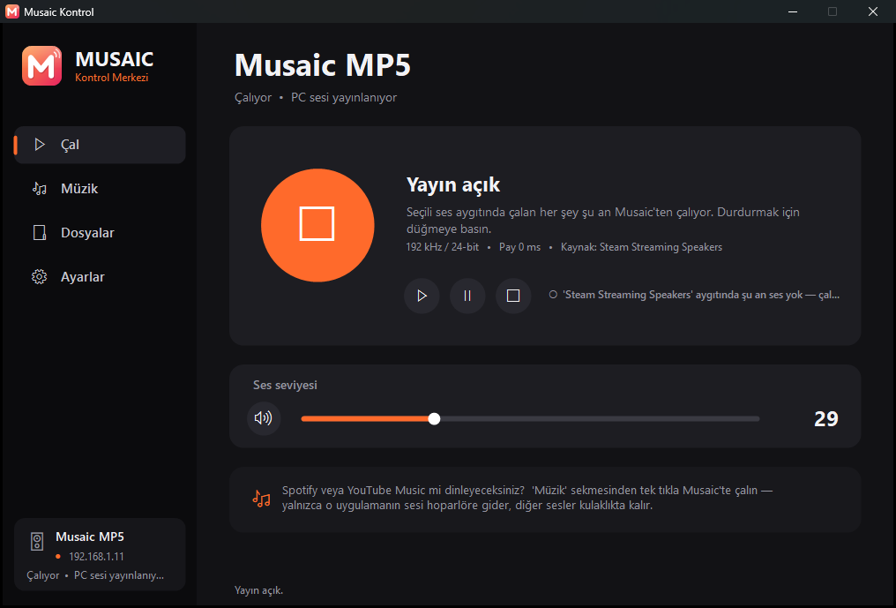

# Musaic Kontrol

🌐 **English** · [Türkçe](README.tr.md)

**A free, open-source Windows app that brings Musaic MP5 / MP10 / MPL Wi-Fi speakers back to life after the official Musaic app was discontinued.**



Musaic Ltd. is gone and its official app no longer works, which left many perfectly good hi-fi speakers stuck. The network player inside them is still fine, though: it speaks standard **UPnP/DLNA**. This app uses that to find, control and stream to the speaker — no account, no cloud, no install.

> The user interface is currently in **Turkish**. Menu names below are given in Turkish with their English meaning, e.g. **Ayarlar (Settings)**. Translations are welcome — see [Contributing](#contributing).

## Features

- **Stream your PC's audio to the speaker** — YouTube, Spotify, games, anything playing on the PC comes out of the Musaic over Wi-Fi.
- **Spotify & YouTube Music, one click** — route *only* that app to the speaker while games, Discord etc. stay on your headphones (per-app audio routing).
- **Lossless file playback** — MP3, FLAC, WAV, M4A, OGG… with drag and drop.
- **High quality** — up to 192 kHz / 24-bit streaming, a studio-grade windowed-sinc resampler (SNR > 105 dB), and a bit-exact "maximum quality" mode.
- **Low latency** — close to Bluetooth, with an adjustable safety buffer.
- **Volume, mute, play/pause** control and a live **"is there any sound?" signal indicator**.
- **Always-on music hub mode** — start with Windows, run in the system tray, start streaming automatically and recover by itself if the speaker reboots. Turn a spare mini PC into a Spotify-to-Musaic bridge.
- Modern dark UI, **no installation**: a single small `.exe`.

## Getting started

1. Download `MusaicKontrol.exe` from the [Releases](../../releases) page — **or** build it yourself (below).
2. Run it. If Windows Firewall asks, **allow access** (the speaker pulls the audio stream from your PC).
3. The app discovers the speaker on your network automatically.

### Building from source

Nothing to install: it uses the C# compiler that ships with the .NET Framework built into Windows.

```bat
derle.bat
```

(`derle` = "build". The output is `MusaicKontrol.exe`.)

## Connecting the speaker to Wi-Fi without the official app

If the speaker doesn't show up on your network, its Wi-Fi settings may have been lost:

1. **Hold the speaker's WPS button for 5–10 seconds** → it starts an open setup network named `Musaic_xxxxxx`.
2. Join that network from a PC or phone and open **`http://172.19.42.1`** in a browser.
3. Give the speaker a name → pick your home Wi-Fi → enter the password → **Connect**.
4. **Power-cycle the speaker** (needed if there's no sound right after setup).

> Many ISP routers have WPS disabled, so pressing WPS on both devices often does nothing. The browser method above always works.

## Troubleshooting

| Problem | Fix |
|---|---|
| No sound and the **Çal (Play)** tab says "○ … şu an ses yok" (*no sound on this device*) | The app only sends audio from the device selected in **Ayarlar (Settings) → Musaic'e gönderilecek ses aygıtı** (*audio device to send to Musaic*). Make the playing app output to that device (Windows sound menu), or use the Spotify / YouTube Music buttons on the **Müzik (Music)** tab. |
| No sound but it says "● Ses geliyor" (*sound detected*) | Power-cycle the speaker; disconnect any phone connected over **Bluetooth** (Bluetooth takes priority over network audio); check the speaker volume. |
| Sound stops after restarting the app or the speaker | Enable **Ayarlar → Yayını otomatik başlat ve koru** (*auto-start and keep streaming*, on by default) — the stream recovers within ~15 s. |
| Audio drops out, then continues ~3 s behind | Increase **Güvenlik payı** (*safety buffer*) by 100–200 ms. When its buffer runs dry, the Musaic re-buffers about 3 seconds. |
| Too much latency | Lower the safety buffer; use the "192 kHz / 24-bit" format. |
| Send only certain apps to the speaker | Use a virtual audio device, e.g. [VB-Audio Virtual Cable](https://vb-audio.com/Cable/) or "Steam Streaming Speakers" if Steam is installed, and select it in Settings. |

### Speaker status light (from the owner's manual)

**Blue**: on · **Purple**: network standby · **Red**: full standby · light on the **×** button: muted.

### About Spotify

The speaker's built-in **Spotify Connect** (a 2016 SDK) is no longer accepted by Spotify — the app shows it as unsupported. Instead, this app routes the Spotify desktop app's audio to the speaker, and you can still control it from your phone via **Spotify → Devices → your PC**. With an always-on mini PC this works even when your main computer is off — see the setup guide [MINIPC_KURULUM.md](MINIPC_KURULUM.md) (Turkish).

## How it works

- The speaker is discovered via **SSDP** as a **UPnP MediaRenderer** (AVTransport + RenderingControl).
- PC audio is captured with Windows **WASAPI loopback**, resampled/encoded, and served as an endless WAV stream from a small HTTP server built into the app; the speaker is told to play it with `SetAVTransportURI` + `Play`.
- The Musaic is very sensitive to buffer underruns (it re-buffers ~3 s), so the stream is fed smoothly, the server backlog is capped and an optional safety buffer is sent up front.
- Per-app routing uses the Windows "app volume and device preferences" feature.

The speaker's hardware is a Qualcomm **AllPlay** module (CUS227) running OpenWrt, which is why its setup page is a LuCI web UI at `172.19.42.1`. Other AllPlay-based speakers may work too — reports are welcome.

## Contributing

Issues and pull requests are welcome — especially:
- an **English (or other language) UI**,
- test reports from **MP10 / MPL** and other AllPlay / DLNA speakers.

## License & disclaimer

MIT License. This project is not affiliated with or endorsed by Musaic Ltd.; the name "Musaic" is used only to describe compatibility.
